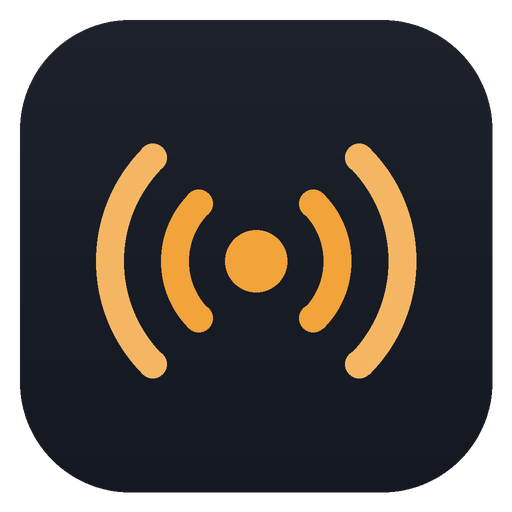

<p align="center">
  
</p>

<h1 align="center">Radiodex</h1>

<p align="center">
  Rádios da internet no Windows que não param: quando a rádio muda o link do stream,<br>
  o Radiodex encontra o novo sozinho. Grave programas com cada música marcada no segundo exato.
</p>

<p align="center">
  <a href="README.md">English</a> · <b>Português</b>
</p>

<p align="center">
  <a href="https://github.com/filipembcruz/radiodex/releases/latest/download/Radiodex.exe"><b>⬇ Baixar Radiodex.exe</b></a><br>
  <sub>Windows 10 (2004+) ou 11 · 64 bits · grátis e de código aberto (MIT)</sub>
</p>

---

## Instalação (1 minuto)

1. Baixe o **Radiodex.exe** na [última versão](https://github.com/filipembcruz/radiodex/releases/latest).
2. Execute. Não tem instalador nem nada a mais para instalar: o .NET já vem dentro.
   Na primeira vez, o Radiodex se instala em `%LocalAppData%\Programs\Radiodex` (sem precisar de administrador) e cria
   atalhos na **Área de Trabalho** e no **menu Iniciar**. Depois você pode apagar o arquivo baixado.
3. Opcional: botão direito no atalho → **Fixar na barra de tarefas** (o Windows só deixa você mesmo fazer isso).

> **SmartScreen:** o app ainda não tem assinatura digital, então o Windows pode mostrar "O Windows protegeu o computador" na primeira vez.
> Clique em **Mais informações** → **Executar assim mesmo**.

Para desinstalar, apague as pastas `%LocalAppData%\Programs\Radiodex` e `%AppData%\Radiodex` e os dois atalhos.

## Funcionalidades

**Encontrar rádios**
- Busque dezenas de milhares de rádios do mundo por nome, cidade ou estilo (catálogo [Radio Browser](https://www.radio-browser.info)) e ouça antes de adicionar.
- Ou cole um link do **radios.com.br**, **Radio Garden**, uma playlist (`.m3u`, `.pls`, `.asx`) ou o stream direto.

**Links que se consertam sozinhos**
- Se o stream parar, o Radiodex pergunta o link atual para a fonte da rádio, depois procura a rádio no catálogo aberto, e troca sem você fazer nada.
- Tenta de novo com intervalos crescentes (10 s, 30 s, 2 min e depois a cada 5 min) e mostra o que está fazendo.
- Botão **Atualizar link** para verificar na hora.

**Ouvir**
- Tocar / pausar, volume, favoritas.
- **Renomeie qualquer rádio e coloque sua própria capa** (lápis ao lado do nome, ou botão direito na lista). O nome também é usado nas gravações.
- Mostra a música tocando agora (quando a rádio envia) e a lista "tocou recentemente".
- Usa o player do próprio Windows: as **teclas de mídia** do teclado funcionam e o painel de volume do Windows mostra o logo da rádio e a música. Próxima/anterior troca de rádio.
- ♥ **Favorite músicas** e encontre-as em **Músicas favoritas**: busca, abrir no YouTube ou Spotify, exportar para CSV.

**Gravação**
- Salva o stream exatamente como chega (sem recodificar) em `Música\Radiodex`.
- Cria um arquivo `.cue` ao lado de cada gravação com cada música e o segundo em que começou: players como VLC e foobar2000 mostram como lista de faixas.
- Se o link mudar no meio da gravação, ela continua no mesmo arquivo.

**Idiomas:** inglês e português, troca na hora.

## Próximos passos

- [ ] Ícone na bandeja (continua tocando com a janela fechada) e notificações do Windows
- [ ] Mini player (pequeno, sempre no topo)
- [ ] Tela da gravação: linha do tempo das músicas, ajuste de sincronia, cortar em faixas
- [ ] Configurações: iniciar com o Windows, pasta das gravações, ordem das fontes
- [ ] Versão para macOS (nativa em SwiftUI, mesmo formato de dados)

## Compilar o código

Precisa do [.NET 8 SDK](https://dotnet.microsoft.com/download/dotnet/8.0) no Windows.

```bat
build.bat
```

ou manualmente:

```bat
dotnet publish src\Radiodex\Radiodex.csproj -c Release -r win-x64 --self-contained -p:PublishSingleFile=true -o out
```

Cada envio para a `main` compila o app no GitHub Actions e publica uma nova versão com o `Radiodex.exe`.

A estrutura do projeto, como cada fonte funciona e o formato dos dados estão no [README em inglês](README.md#project-structure),
em [`docs/sources.md`](docs/sources.md) e em [`docs/data-format.md`](docs/data-format.md).

### Traduções

Todos os textos ficam em [`src/Radiodex/Services/Loc.cs`](src/Radiodex/Services/Loc.cs), em pares inglês/português.
Pull requests com novos idiomas são bem-vindos.

## Observações

O Radiodex toca streams públicos publicados pelas próprias rádios. As gravações são para uso pessoal;
respeite os direitos das emissoras e dos artistas no seu país.

## Licença

[MIT](LICENSE)
